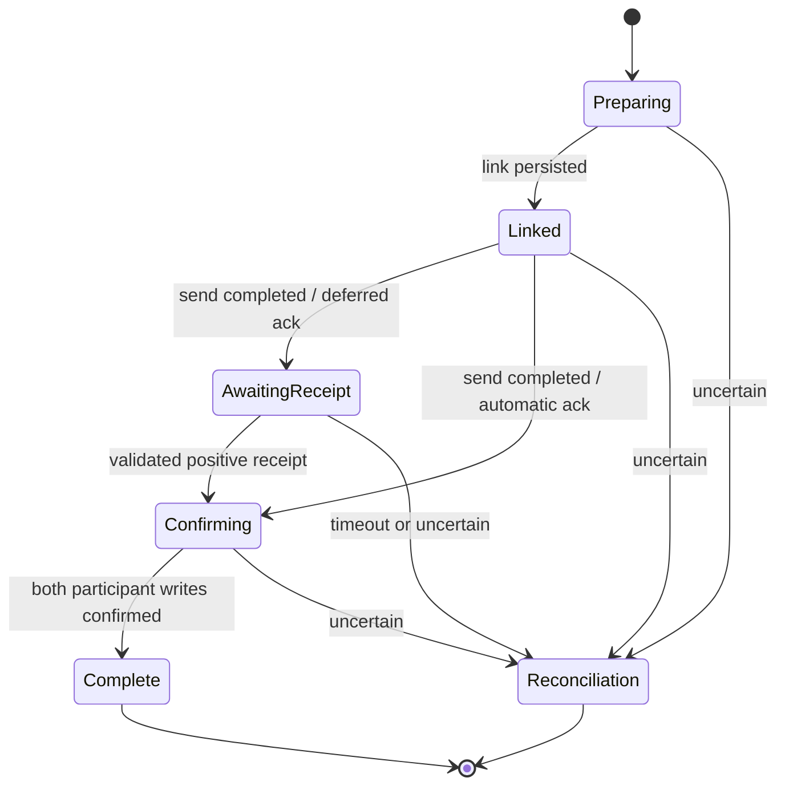

# Acceptance coordination and host model

This model describes a candidate host boundary. The executable trace host in the example is a
failure-injection interpretation of selected *observed* sequences, not an implementation of the durable
host proposed here. Evidence E01–E14 is pinned in [evidence.json](evidence.json).

## Participants and relationships

One acceptance episode references a tender revision, a selected load revision, an original trip needed for
stop mapping, a trading partner, and an outbound attempt. In the proposed design each has an explicit
identity. The archive's tender-ID rewrite (E06) requires an alias/migration record; it must not silently
change the identity of a persisted episode. Existing-load reuse and creation are alternative selection
strategies with different source behavior (E01/E07).

| Relationship | Kind | Boundary |
|---|---|---|
| Tender references selected load | Identity/reference integrity | Load existence must be evidenced before the send; not a global rule for all unaccepted tenders. |
| Accepted/pending tender references load with pending acknowledgement | Stable episode checkpoint | Intermediate independent writes can temporarily disagree. |
| Confirmed tender and acknowledged load | Completion condition | Required to declare the proposed episode complete; not claimed as an invariant of every legacy snapshot. |
| Original trip supplies stop mapping | Data dependency | Does not imply a trip lifecycle transition. |
| Receipt refers to outbound attempt | Protocol correlation | Source has partner/control-number matching, including historical numbers. Proposed current-attempt validation needs an explicit policy. |

The test using `MachineCoherenceBuilder` intentionally fails independent-interleaving analysis: a load
machine can acknowledge before the linkage machine attaches. A declarative allowed-pair relation describes
a requirement; it does not coordinate updates or supply a transaction. For a realization using separate
writes, track intermediate progress and enforce the completion condition at the coordinator boundary.
Do not merely declare immediate coherence and report it as achieved.

## Proposed coordinator

The fluent `Coordination()` source is a control-flow sketch. Its unguarded completion signals are *trusted
host observations*, never raw caller commands. Before producing them, the host must validate the episode,
participant revisions, effect receipt and correlation. The detailed tender machine additionally gates
receipt confirmation on positive/correlated evidence (P01).

`reconciliation-required` is terminal for this sketch. It means the automatic episode stops, not that
repair is impossible. Repair/retry authoring is deferred until effect idempotency and receipt semantics
are understood. A negative or unmatched receipt must not produce `receipt-confirmed`: retain it as
unmatched evidence or route a correlated negative response to reconciliation according to a declared
provider policy. This is a proposal, not the observed E04 behavior.

## Effect contracts for a future host

| Effect | Explicit inputs | Required completion evidence / failure handling |
|---|---|---|
| Resolve or create load | Tenant, tender reference, selection policy | Selected identity/revision, original trip and stop mapping. Distinguish created, reused, orphaned and duplicate. E01/E02/E07. |
| Persist linkage | Expected tender revision, load reference, aliases and stop mapping | Committed revision. A create/link operation must be recoverable by a stable episode key after an uncertain response. |
| Send acceptance | Partner, payload contract, attempt/control identifiers | Send receipt with automatic/deferred acknowledgement classification and archived message reference. A transport timeout is not proof of non-delivery. |
| Persist tender acceptance | Expected revision, auto/deferred result, injected timestamp/deadline | Committed accepted/pending or confirmed observation, including link and protocol flags. Source paths currently differ in ordering. |
| Mark load acknowledgement | Load identity/revision and acknowledgement value | Committed load revision. E08 only changes acknowledgement/matching/source facts, not load/trip status. |
| Receive acknowledgement | Partner/control identifiers, raw result, observation time | Correlated attempt plus interpreted result. E12 provides useful matching evidence, but does not by itself settle stale/duplicate policy. |
| Publish notifications | Committed change identity and relevant projections | Delivery receipt or durable pending-publication record. Notification failure must be distinguishable from participant-write failure. |

Host effect receipts should retain episode ID, effect identity, attempt identity, participant revisions,
result classification and provenance. These are required semantics for the proposal, not new public types
introduced by this sketch. Reuse Cohesive execution references, Process effect contracts and diagnostics
when implementing the host. Machine guards consume explicit facts; they must not perform database queries,
read wall-clock time, generate control numbers, or call an EDI client.

The coordinator would use Transitions for local entity decisions/patches and Processes for sequencing,
waiting and recovery. A realization must state its transaction and delivery capabilities. If it cannot
atomically persist a state change and outbound intent, it must report that limitation and use an explicit
reconciliation strategy; it cannot claim exactly-once external delivery. No live Process lowering or
adapter conformance claim is made here.

## Observed execution and failure matrix

`T` is tender acceptance persistence; `L` is load acknowledgement persistence. Both source paths first
create a new load and persist the link for the fixture's creation branch, then send acceptance.

| Branch | After send | Failure before second write |
|---|---|---|
| Legacy / auto | L confirmed, then T confirmed | Load acknowledged; tender acceptance not persisted. |
| ES / auto | T confirmed, then L confirmed | Tender confirmed; load acknowledgement not persisted. |
| Legacy / deferred | L pending, then T pending | Load pending; tender acceptance not persisted. |
| ES / deferred | T pending, then L pending | Tender pending; load marking not completed. |
| Later receipt, load not acknowledged | L confirmed, publish trip update, T confirmed | Notification failure leaves acknowledged load and pending tender. |
| Later receipt, load already acknowledged, no updates/cancellation | Persist acknowledgement log | Does not clear the pending tender flag in this inspected branch. |

Failure before `SendAcceptance` in the trace host leaves a created, linked load. Failure after a remote send
but before its response is not modeled as a known failure: it is an uncertain outcome requiring reconciliation.
The acceptance method's later visibility/appointment publications may also fail after participant writes and
return an overall failure (E03). Those publications are documented but disabled in executable fixtures.

No blind rollback, resend, or compensation is inferred. Cancelling a newly created load to compensate for
an uncertain send could contradict a partner that already accepted the response.

## Proposal source map

| Source node | Evidence | Interpretation |
|---|---|---|
| Tender `send-pending`, `send-confirmed` | E01/E03/E05/E09/E10 | Captures successful acceptance distinctions; admission summary assumes host-resolved facts. |
| Tender `receipt-confirmed` | E04/E05/E12 + P01 | Observed confirmation with a deliberately stronger positive-result guard. |
| Linkage `attach-load` | E02/E06/E07 | Episode-level link transition; alias migration and stop changes remain accompanying domain operations. |
| Load `accept-pending`, `confirm` | E08/E11 | Acknowledgement projection only. |
| Coordination `link-persisted`, `send-*`, `participants-confirmed` | E02/E03/E04 + P02 | Proposed progress observations over non-atomic effects. |
| Coordination `uncertain-*` | E03/E04 + P02 | Explicit recovery boundary, without inferred retry semantics. |

## Acceptance criteria for promoting this sketch

1. Resolve Q01–Q06 with domain owners and provider-specific evidence.
2. Capture real success and injected-failure traces at the source application's persistence/send boundaries;
   compare with the golden observations here. Include both feature-flag paths and existing-load linkage.
3. Specify deadline, historical receipt, duplicate, and retry behavior; inject clock/control IDs explicitly.
4. Map local state changes to canonical Transitions and lower coordination through existing Process authoring.
5. Demonstrate adapter capability requirements and conformance for crash/restart between each effect.
6. Review migration from identity rewriting and persisted legacy flag combinations before activation.
