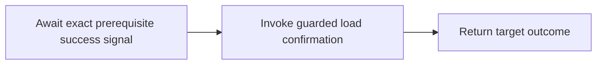

# Causal tender reactions

Confirmation may arrive before the acceptance receipt that precedes it in the business lifecycle.
The source feed can acknowledge both deliveries independently. Delivery order does not grant the
load permission to confirm; the reaction declaration specifies the prerequisite:

```csharp
PendingAcceptance = MachineReaction.On<TenderState>(
        Tender.Entity, Tender.Machine.SendPending,
        id: "tender-to-load.pending", revision: "2")
    .OncePerSourceEntity()
    .Request(MarkPending,
        subject: tender => tender.LoadId,
        input: tender => new AcknowledgeLoad(false));

ReceiptConfirmation = MachineReaction.On<TenderState>(
        Tender.Entity, Tender.Machine.ReceiptConfirmed,
        id: "tender-to-load.confirmed", revision: "2")
    .After(PendingAcceptance)
    .Request(Confirm,
        subject: tender => tender.LoadId,
        input: tender => new AcknowledgeLoad(true));
```

These are the compiled declarations in `TenderReactionModel.cs`. The source shape and exact machine
binding must match. `.After` selects source-entity identity for the dependent as well, and requires
that the prerequisite explicitly declare that scope. This profile means **one occurrence of each
policy per source entity lifetime**. The stable identity includes exact policy revision/fingerprint,
authority, tenant and source entity type/key. It does not use the load ID or transport ordering.
Duplicate delivery of the same receipt replays. A second distinct receipt trying to occupy that same
one-shot identity fails admission, even if its projected command is identical.

The tender episode does not repeat its acceptance edge. Reusable entities with multiple acceptance
episodes need an explicit episode key; that authoring surface is not implemented here. Do not reuse
a deleted tender's key as a new lifecycle under the same policy revision. The example revisions advance
to `2`; old admitted reactions retain their old identities and definitions. Deploy the exact old and
new policies intentionally, and do not replay old history under the new revisions without a plan.

## Process interpretation

The dependent lowers to an ordinary three-node Process:



The reaction document embeds its exact prerequisite declaration. Lowering derives a signal contract
whose identity pins that prerequisite fingerprint. Validation verifies the wait, contract, entry and
continuation before compilation. The independent reaction retains its existing two-node Process.
Source maps and execution fingerprints use the existing Process authoring pipeline.

The first finite activation registers the durable wait. A later recovery pass looks up the prerequisite
by its deterministic instance identity in the same Process store. It authorizes evidence access and
resolves the exact target receipt through the prerequisite's target adapter. Only Applied/NoChange
receipt evidence releases the wait; neither Process completion alone nor dispatch acceptance suffices.

The host then admits one stable signal into the dependent's existing durable inbox. Its origin pins the
prerequisite Process definition, instance, attempt and target-invocation occurrence; its payload retains
the target commit fingerprint. It addresses the exact dependent wait/token and authority. The inbox is
a trusted execution boundary: applications must not expose an unauthenticated way to inject these
internal success signals. Other interpretations must verify equivalent receipt evidence before releasing
the wait. This host checks retained signal affinity and rejects wrong source instances or wait targets.

Signal admission and activation are separate recoverable boundaries. A crash between them leaves the
same input available for replay. Once durably admitted, the proof need not be fetched from the target
again. Registration and signal consumption have distinct stable activation identities; retries of the
confirmation reuse its original operation identity. The target still applies fresh authorization and
its own state/guard checks. No machine callbacks, second scheduler or mutable coordination journal is added.

## Hosting

Use the existing pending-acceptance host from `hosting.md`. Bind the confirmation target and give its
host the exact prerequisite host:

```csharp
var confirmationTarget = MachineReactionTarget.Local(
    new ProcessTransitionOperationBinding(
        model.Confirm.Compile().Plan!, loadRepository, interactionContracts),
    authority: organizationScope,
    authorizeEntity: authorizeLoad);

var confirmationHost = new MachineReactionHost(
    policy: model.ReceiptConfirmation,
    store: processStore,
    target: confirmationTarget,
    authorizeSource: authorizeTenderAndStart,
    options: new ProcessDurableRuntimeOptions(
        workerId: workerInstance, workerLease: TimeSpan.FromMinutes(5)),
    recovery: new MachineReactionRecoveryPolicy(authorizeRetainedStart),
    prerequisite: host);

var recovery = new MachineReactionRecovery(
    source: processStore,
    hosts: [host, confirmationHost]);
```

Registration rejects missing or mismatched prerequisite revisions, authorities, stores, or recovery
policies. Each source subscription still calls `AdmitAsync` without contacting either target. A worker
pages both policies; confirmation can wait through arbitrarily ordered pages and worker replacement.
The host does not implicitly execute the prerequisite: register it for recovery as shown.

This implementation requires the same Process storage authority and logical tenant. Source transport
may be Cosmos and targets may be native or HTTP. Cross-store joins, multiple-prerequisite joins,
compensation and automatic abandonment require additional semantics.

## Evidence and failure

`MachineReactionProgress.Prerequisite` identifies the exact required instance. Diagnostics distinguish:

| Condition | Dependent progress | Dispatch |
|---|---|---|
| Prerequisite absent or unfinished | Pending / `machine.reaction.prerequisite.waiting` | None |
| Prerequisite commitment uncertain | Pending / `machine.reaction.prerequisite.indeterminate` | None |
| Prerequisite rejected | Failed / `machine.reaction.prerequisite.rejected` | None |
| Prerequisite known failed | Failed / `machine.reaction.prerequisite.failed` | None |
| Successful prerequisite, confirmation guard rejects | Rejected with confirmation receipt | One conclusive request |
| Confirmation acknowledgement lost | Indeterminate with its own attempt evidence | Same operation replay |

A failed prerequisite does not consume the dependent's physical dispatch budget. The wait remains
durably inspectable and nonterminal; background passes can report the same blocked failure. This change
does not silently cancel the Process or synthesize a target rejection. Operator abandonment, dead-letter
retention and garbage collection are separate work. Retain prerequisite starts and receipts until every
dependent has retained its release proof. The authored wait requests a 30-day minimum retention horizon;
it has no timer clause or automatic deadline.

Tests exercise confirmation-first delivery, in-memory serialization and a new PostgreSQL connection
pool, ambiguous acceptance, lost confirmation acknowledgement, concurrent release, independent target
guards, source-entity isolation, conflicting one-shot reuse, fresh prerequisite authorization, malformed
IR and mismatched release evidence. They assert no confirmation mutation while blocked and no repeated
load mutation after acknowledgement loss.
